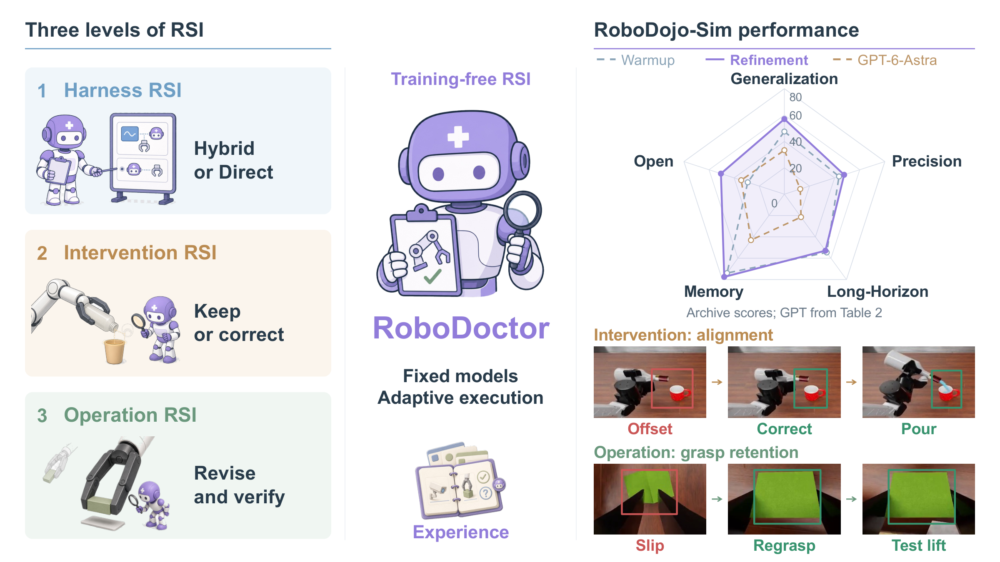
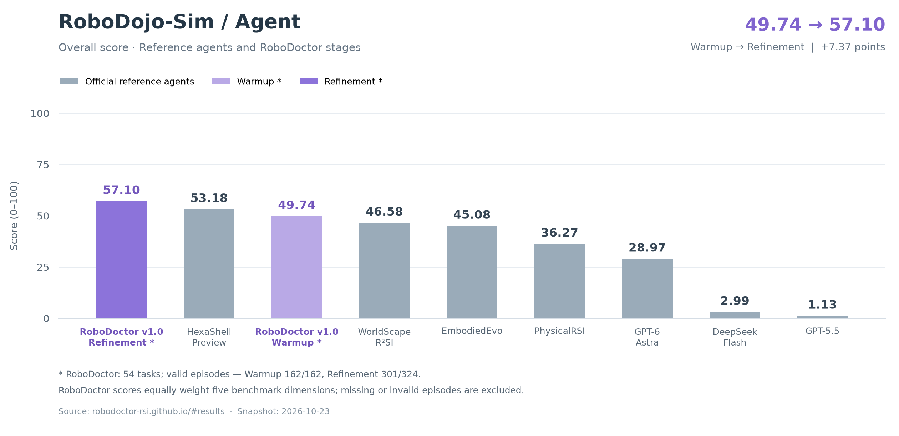

# RoboDoctor: Training-Free Recursive Self-Improvement for Robot Policies

Heyang Yu<sup>1,\*</sup>, Haomin Li<sup>1,\*</sup>, Sihang Li<sup>2</sup>, Jixin Yan<sup>3</sup>, Shiyun Peng<sup>1</sup>, Wanqi Zhong<sup>1</sup>, Tianyu Xin<sup>1</sup>, Yuan Yao<sup>1</sup>, Xiaoyu Tian<sup>1,†</sup>, Yiming Li<sup>1,†</sup>

<sup>1</sup>Tsinghua University  <sup>2</sup>New York University  <sup>3</sup>Northwestern University

<sup>*</sup>Equal contribution  <sup>†</sup>Equal correspondence

[Project website](https://robodoctor-rsi.github.io/) ·
[Paper](https://robodoctor-rsi.github.io/tech_report.pdf) ·
[PrismWAM RoboDojo models](https://huggingface.co/THUSI-Lab/PrismWAM/tree/main/robodojo)

[](assets/overview.pdf)

RoboDoctor improves robot control without updating the learned policy weights.
Within an episode it observes RGB-D and robot state, diagnoses a proposed policy
chunk, and either releases a prefix or applies a bounded correction. Across
episodes it accumulates verified intervention and operation experience, while a
harness selects hybrid or direct control. See the project website for the method
and research results; this README describes the implementation and setup.


## Results



RoboDoctor improves from **49.74** (Warmup) to **57.10** (Refinement), a gain of
**7.37 points**. The local results cover **54 tasks**, with **162/162** valid
Warmup episodes and **301/324** valid Refinement episodes. Overall scores equally
weight the five benchmark dimensions; missing or invalid episodes are excluded.


## Supported workflows

- **Direct:** a model controls grounded end-effector and joint tools (`gpt_only`).
- **Hybrid:** a model supervises Pi05 proposals (`pi05_plus_gpt`).
- **RSI:** iterative policy diagnosis and 1–5-step interventions, with PrismWAM or
  Pi05 (`rsi_policy_doctor`).
- **Pipeline:** three RSI trials followed by an RSI or direct tail, with persistent
  experience and explicit evaluation checks.

The default PrismWAM backend uses the official RoboDojo RGB-memory release:
32 predicted actions, a 16-step execution window, 10 inference steps, and three
independently encoded RGB observations: episode start, 32 steps ago, and current.
Missing early history repeats the earliest observation. Every recorded policy or
intervention step updates the same observation history. The unused prediction
suffix is discarded and subsequent decisions use fresh observations.

## Repository layout

```text
robodoctor/                 controllers, geometry, launchers, prompts, policy adapter
hybrid_rollout/             simulator RPC and supporting runtime dependency closure
third_party/prismwam/       pinned inference implementations and licenses
scripts/                   environment checks and verified model downloads
tests/                     regression tests
codex.toml                 credential-free model provider configuration
runtime.local.sh.example   local simulator/policy path template
AGENT.md                   contributor and coding-agent instructions
```

The import package is `robodoctor`; the distribution is named `RoboDoctor`.
This source distribution includes no Git metadata, private configuration,
experiment results, local environments or large model weights. Copyright notices
and upstream licenses are retained.

Only eight shell scripts are included:

| Script | Purpose |
| --- | --- |
| `run_codex.sh` | Direct control and optional smoke/tower modes. |
| `run_rsi.sh` | RSI episode with an optional experience document. |
| `run_hybrid.sh` | Pi05 hybrid episode. |
| `run_pipeline.sh` | Iterative evaluation pipeline. |
| `run_server.sh` | Simulator process managed by the launchers. |
| `runtime_env.sh` | Shared explicit environment configuration. |
| `setup_curobo_runtime.sh` | Optional local NVRTC compatibility libraries. |
| `hybrid_rollout/robodojo/robodojo_server/runtime.sh` | Simulator graphics environment. |

## Environment setup

Use Linux with an NVIDIA GPU, a compatible driver, working Vulkan/EGL, Git LFS,
Conda, Node.js/npm, and a C/C++ toolchain. RoboDojo requires Isaac Sim 5.1 and its
matching Isaac Lab/CuRobo dependencies. Model inference and simulation can use
separate GPUs and Python environments. Resource use depends on the selected
models; allow about 26.4 GB for the listed policy/text assets, plus simulator
assets, environments and caches.

The commands below use Bash. They do not install Conda, change drivers or modify
system libraries. Start in this source directory and activate your Conda shell:

```bash
eval "$(conda shell.bash hook)"
export ROBODOCTOR_SETUP_ROOT="$(pwd)"
export ROBODOCTOR_DEPS_DIR="$ROBODOCTOR_SETUP_ROOT/runtime/deps"
export ROBODOCTOR_MODELS_DIR="$ROBODOCTOR_SETUP_ROOT/runtime/models/prismwam"
mkdir -p "$ROBODOCTOR_DEPS_DIR" "$ROBODOCTOR_MODELS_DIR"
```

### 1. Simulator and assets

If you already have a working RoboDojo environment, reuse it and record its
Python executable and source directory. For a new environment:

```bash
conda create -n RoboDojo python=3.11 -y
conda activate RoboDojo
export ROBODOCTOR_SIM_PYTHON="$(python -c 'import sys; print(sys.executable)')"

git clone https://github.com/RoboDojo-Benchmark/RoboDojo.git "$ROBODOCTOR_DEPS_DIR/RoboDojo"
cd "$ROBODOCTOR_DEPS_DIR/RoboDojo"
git checkout 08b7ee46034c3d0c8a389b2b7bfc138f4d55ee4d
bash scripts/install.sh --from base_deps
bash scripts/init_assets.sh
python utils/update_embodiment_config_path.py
python -m pip install -e "$ROBODOCTOR_SETUP_ROOT[test]"
python -m pip check
git submodule status --recursive
cd "$ROBODOCTOR_SETUP_ROOT"
```

The upstream installer prepares Isaac Lab, CuRobo and XPolicyLab. Its submodule
steps can update revisions, so record the resolved submodule versions for
reproduction. Resume a failed installation at the relevant upstream stage; do not
run system/Conda installation stages if those components are already managed.
See [RoboDojo installation](https://robodojo-benchmark.com/doc/usage/install-and-download/).
Ensure Git LFS files are real assets, not pointer text. After moving RoboDojo or
its assets, rerun `utils/update_embodiment_config_path.py`.

### 2. Model access

Install the pinned Codex CLI into the local runtime directory:

```bash
npm install --prefix "$ROBODOCTOR_SETUP_ROOT/runtime/tools/codex" @openai/codex@0.153.4
export ROBODOCTOR_CODEX_BIN="$ROBODOCTOR_SETUP_ROOT/runtime/tools/codex/node_modules/.bin/codex"
"$ROBODOCTOR_CODEX_BIN" --version
```

Controllers use its `app-server` protocol. `codex.toml` uses the OpenAI Responses
endpoint and an environment variable; select a model available to your account.
For a custom Responses-compatible provider, copy the configuration to ignored
`config.toml` or `*.local.toml`, edit its model/provider/base URL, and pass
`--codex-config PATH`. `gemini.toml.example` is an optional provider template;
its placeholder endpoint must be configured before use.

```bash
read -rs -p 'OPENAI_API_KEY: ' OPENAI_API_KEY
echo
export OPENAI_API_KEY
```

Alternatively, pass `--key-file /path/to/private-key-file`. The `env_key` field
is the **environment variable name**, never the credential itself. Each episode
creates isolated Codex state. Do not commit credentials or generated run folders.
`--source-config` remains an alias for `--codex-config`; the optional legacy
`--auth-profile openai` selects the public OpenAI preset. Custom providers should
use explicit TOML configuration.

### 3. PrismWAM inference environment

Skip this step for direct control. Install the bundled inference packages in a
separate environment; no external source checkout is needed:

```bash
conda create -n robodoctor-prismwam python=3.11 -y
conda activate robodoctor-prismwam
export ROBODOCTOR_POLICY_PYTHON="$(python -c 'import sys; print(sys.executable)')"
python -m pip install --upgrade pip
python -m pip install torch==2.7.1 torchvision==0.22.1 --index-url https://download.pytorch.org/whl/cu128
python -m pip install numpy==1.26.4
python -m pip install -e "$ROBODOCTOR_SETUP_ROOT/third_party/prismwam"
python -m pip install -e "$ROBODOCTOR_SETUP_ROOT"
python -m pip check
```

The official [PrismWAM](https://github.com/THUSI-Lab/PrismWAM) inference
implementation is packaged under `third_party/prismwam`. RoboDoctor uses its
public deployment API, action normalization and RGB history sampler.
Select `--student-backend prismwam` and `--student-model prismwam5b`;
configure the runtime with `PRISMWAM_*` environment variables.

### 4. Download the official RoboDojo model

```bash
"$ROBODOCTOR_POLICY_PYTHON" scripts/download_prismwam.py --output "$ROBODOCTOR_MODELS_DIR" --dry-run
"$ROBODOCTOR_POLICY_PYTHON" scripts/download_prismwam.py --output "$ROBODOCTOR_MODELS_DIR"
```

Downloads are pinned in `robodoctor/prismwam/assets.json`, checked for size and
SHA256, and reusable across reruns. The official model revision is
`f4951104284f092d23af01f544a4e1ac716b2e84`. The policy, both VAEs, normalization
statistics and original configuration come from
[THUSI-Lab/PrismWAM/robodojo](https://huggingface.co/THUSI-Lab/PrismWAM/tree/main/robodojo).
T5 and tokenizer files come from the pinned public Wan2.2 model repository,
as required by the official PrismWAM loader.

```text
prismwam/
├── robodojo/
│   ├── policy.pt
│   ├── config.yaml
│   ├── action_stats.pt
│   ├── depth_vae.pt
│   └── rgb_vae.safetensors
└── Wan-AI/
    └── Wan2.2-TI2V-5B/
        ├── models_t5_umt5-xxl-enc-bf16.pth
        └── google/umt5-xxl/
            ├── special_tokens_map.json
            ├── spiece.model
            ├── tokenizer.json
            └── tokenizer_config.json
```

Use the matching RGB/depth VAEs and statistics, not assets from another release.
The bundled `robodoctor/prismwam/config.yaml` uses the official architecture and
normalizer with explicit environment-based paths and online text encoding.
The downloaded portable `robodojo/config.yaml` is also accepted with
`PRISMWAM_CONFIG`; its adjacent VAEs/statistics must remain in place.
This adapter targets the public RoboDojo release: 14-dimensional physical joint
actions, a 32-step prediction horizon and a 16-step execution horizon. The loader
checks the configured assets before inference; download all pinned text assets
first. Camera depth comes from RoboDojo in metres and is explicitly converted to
the model's millimetre range.

### 5. Local configuration

```bash
cd "$ROBODOCTOR_SETUP_ROOT"
cp runtime.local.sh.example runtime.local.sh
```

Fill in your own absolute paths. If you followed the steps above in one shell,
you can write the selected values directly:

```bash
cat > runtime.local.sh <<EOF
export ROBODOJO_SOURCE="$ROBODOCTOR_DEPS_DIR/RoboDojo"
export ROBODOJO_PYTHON="$ROBODOCTOR_SIM_PYTHON"
export CODEX_BIN="$ROBODOCTOR_CODEX_BIN"
export CODEX_CONFIG="$ROBODOCTOR_SETUP_ROOT/codex.toml"
export PRISMWAM_PYTHON="$ROBODOCTOR_POLICY_PYTHON"
export PRISMWAM_CHECKPOINT="$ROBODOCTOR_MODELS_DIR/robodojo/policy.pt"
export PRISMWAM_CONFIG="$ROBODOCTOR_SETUP_ROOT/robodoctor/prismwam/config.yaml"
export PRISMWAM_ASSETS_ROOT="$ROBODOCTOR_MODELS_DIR"
export PRISMWAM_DEPTH_VAE="$ROBODOCTOR_MODELS_DIR/robodojo/depth_vae.pt"
EOF
source ./runtime_env.sh
```

Direct-only runs need the first four settings. `ROBODOJO_SOURCE` and
`ROBODOJO_PYTHON` are required for all shell launchers. The remaining settings are
for PrismWAM. Local configuration is ignored by Git if you later initialize a
repository. Credentials should remain in environment variables or private files.

The simulator detects system NVIDIA/Vulkan/EGL libraries. For an existing custom
bundle, explicitly set `DAGGER_NVIDIA_RUNTIME`, `DAGGER_SYSROOT`,
`VK_ICD_FILENAMES`, `__EGL_VENDOR_LIBRARY_FILENAMES` and, if needed,
`SIM_EXTRA_LIBRARY_PATH`. On GPUs where NVRTC rejects the CUDA architecture,
`bash setup_curobo_runtime.sh` installs only the required NVRTC libraries under
`runtime/curobo_nvrtc/`.

### 6. Validation and first run

```bash
source ./runtime_env.sh
"$ROBODOJO_PYTHON" scripts/check_environment.py --mode direct
"$ROBODOJO_PYTHON" scripts/check_environment.py --mode prismwam
"$ROBODOJO_PYTHON" -m pytest -q
bash run_pipeline.sh --dry-run
```

Preflight and a dry run do not prove GPU rendering or full policy inference.
The following smoke run contacts your configured model API and starts simulation:

```bash
bash run_codex.sh --task build_tower --smoke-approach --max-decisions 5 \
  --gpu 0 --output results/direct_smoke
```

To check the policy service separately, start it with an available GPU:

```bash
CUDA_VISIBLE_DEVICES=1 "$PRISMWAM_PYTHON" -m robodoctor.prismwam_server \
  --checkpoint "$PRISMWAM_CHECKPOINT" --variant prismwam5b --device cuda:0 --port 18830 \
  --identity-output runtime/prismwam_identity.json
# In another terminal:
curl --fail http://127.0.0.1:18830/healthz
curl --fail http://127.0.0.1:18830/metadata
```

Stop the standalone service before a launcher starts its own policy server.
A single GPU can be selected for both services if it has enough memory; otherwise
use separate simulator and policy GPUs.

### 7. Optional Pi05 backend

Install OpenPI and Pi05 in a separate environment following
[XPolicyLab](https://github.com/XPolicyLab/XPolicyLab/blob/main/README.md).
From RoboDojo, `bash scripts/RoboDojo/download_ckpt.sh huggingface Pi_05` downloads
the checkpoint. It must contain `params/` and
`assets/arx_x5_sim/norm_stats.json`; the OpenPI source must register
`pi05_base_aloha_full_sim_arx-x5_seed_0`. Set `OPENPI_SOURCE` in local configuration
and supply `--student-python` explicitly:

```bash
bash run_rsi.sh --student-backend pi05 --checkpoint /path/to/pi05/checkpoint \
  --student-python /path/to/pi05/bin/python --output results/pi05_rsi
```

## Running episodes

```bash
# Direct control; full native tower episode.
bash run_codex.sh --task build_tower --tower-test --max-decisions 0 \
  --run-timeout 14400 --output results/tower

# RSI iteration zero, without inherited experience.
bash run_rsi.sh --task build_tower --gpu 0 --student-gpu 1 --output results/rsi_iter0

# Carry intervention experience into the next episode.
bash run_rsi.sh --iteration 1 \
  --intervention-experience /path/to/intervention_experience.md --output results/rsi_iter1

# Original Pi05 hybrid workflow.
bash run_hybrid.sh --checkpoint /path/to/pi05/checkpoint \
  --student-python /path/to/pi05/bin/python --output results/hybrid
```

Direct control retains 0-shot, textual-1-shot and visual-1-shot modes. Run
`bash run_codex.sh --help` for demonstration arguments. Model and reasoning effort
come from the selected TOML; `--effort` overrides the latter. Output directories
must be new, so existing experiments are not overwritten.

## Recursive self-improvement pipeline

```bash
bash run_pipeline.sh --task build_tower --codex-config codex.toml \
  --effort medium --gpu 0 --student-gpu 1 --output results/build_tower_pipeline

# Three RSI trials, followed by six selected-strategy episodes (nine total).
bash run_pipeline.sh --task swap_blocks --tail-iterations 6

# Inspect both paths without simulation or inference.
bash run_pipeline.sh --dry-run
```

The default is nine episodes. Iterations 0–2 run RSI and carry intervention
experience forward. The pipeline averages their native evaluation scores and
compares the percentage against 30:

```text
iter0 RSI -> experience -> iter1 RSI -> experience -> iter2 RSI
  mean native score * 100 < 30:
    iter3 direct (empty experience) -> ... -> iter8 direct
  otherwise:
    Codex Harness improvement from iter2 experience
    -> iter3 RSI -> ... -> iter8 RSI (same improved prompt pair)
```

Equality selects RSI. `--threshold` overrides the percentage. Missing, censored
or invalid evaluations stop the pipeline; they never become zero scores. A
failed launcher also stops execution while preserving artifacts. Successful
episodes do not skip later iterations. The default is unlimited decisions and
a four-hour wall-time limit per episode.

Only the RSI branch starts an independent Codex app-server editing session after
the gate. It reads `experience/iter2.md` and improves the high-level intervention
and verification guidance in a copy of the **RSI** prompts. The resulting
`harness/prompts/SKILL.md` and `harness/prompts/context/teacher_context.md` are
shared by all six tail episodes. Each controller copies and injects that exact
pair; hashes are checked before each episode. Package prompts remain unchanged.
Direct control skips this stage entirely and uses its separate original prompts
in `robodoctor/prompts/`; it never loads the revised RSI pair.

The editor uses the selected Codex configuration, credentials, model and effort,
with a separate runtime home. `--harness-timeout` sets its deadline (default:
900 seconds). Failure, timeout, empty/unchanged output or changed snapshot hashes
stop the pipeline before further episodes. Inspect `harness/evolution.json`,
`harness/summary.md`, and its RPC/stderr logs. Completion validates the editing
process and files; improved robot performance still requires evaluation.
For an individual RSI rollout, `--harness-dir PATH` can reuse a completed
`harness/prompts` snapshot. This option is rejected for direct/hybrid control;
the pipeline always generates its own snapshot.

Default seeds repeat `0, 1, 2` three times; `--seed N` fixes every iteration to N.
`--tail-iterations N` changes the number of post-gate episodes (default: six).
`--eval-seed` defaults to zero. After confirming the first three episodes are
below the gate, you can start only the direct tail in a fresh output directory:

```bash
bash run_pipeline.sh --direct-tail --task align_blocks --iteration-seeds 0 1 2 0 1 2 \
  --codex-config codex.toml --output results/align_blocks_direct_tail
```

`--direct-tail` records a user-confirmed gate; it does not read or validate the earlier run.
The direct tail starts without RSI experience, then carries only direct task
experience into the following episodes. RSI tails preserve cumulative policy
intervention experience. The pipeline stores immutable final snapshots in
`experience/iterN.md`, writable inputs in `experience/input_iterN.md`, launcher
logs in `logs/`, and commands, scores and status in `pipeline.json`.

## Experience and artifacts

`--intervention-experience PATH` is optional. Without it, RSI begins with empty
memory. With it, the document is read and updated in place. The controller saves
`controller/intervention_experience.md` at episode start, after updates and at
completion/cleanup. Its two sections record policy diagnosis and intervention
operations, including both failures and verified policy successes. Memory reuse
must be grounded in fresh observations; old coordinates are not current evidence.

Every direct episode saves `controller/task_experience.md`. A final model turn
summarizes verified methods, failures and uncertainties without simulator tools.
If summarization fails, a labeled evidence fallback preserves prior experience,
TODO and NOTES. Standalone direct runs can pass `--task-experience PATH`.
Simulation evaluation artifacts are stored under `sim/`, controller artifacts
under `controller/`, and service output under `logs/`.

## Troubleshooting

| Symptom | Check |
| --- | --- |
| Missing runtime paths | Fill in `runtime.local.sh`; use absolute simulator/Python paths. |
| Missing USD, URDF or layouts | Finish asset/LFS downloads and update embodiment paths. |
| Policy configuration mismatch | Use matching official config, statistics and both VAEs. |
| T5/tokenizer not found | Rerun the pinned downloader and check `PRISMWAM_ASSETS_ROOT`. |
| Vulkan/EGL startup failure | Verify driver libraries/manifests or configure explicit overrides. |
| CUDA/NVRTC architecture error | Check CUDA compatibility and optional local NVRTC installation. |
| API authentication or model access failure | Check provider, environment variable/key file and model permissions. |
| Policy or simulator startup failure | Read `logs/student.log` or `logs/sim.log`. |

## Acknowledgement

Parts of the direct and hybrid control code are based on
[GPT-as-Policy](https://github.com/anonymous-report-421/GPT-as-Policy).
We thank its authors for making their implementation available.
The policy backend uses the public
[PrismWAM implementation](https://github.com/THUSI-Lab/PrismWAM) and
[released RoboDojo weights](https://huggingface.co/THUSI-Lab/PrismWAM/tree/main/robodojo).

Required third-party notices are preserved in
[THIRD_PARTY_NOTICES.md](THIRD_PARTY_NOTICES.md).
Public PrismWAM source revisions and hashes are recorded under `third_party/prismwam/`.
Model weights, simulators and assets retain their upstream licenses and must be
installed/downloaded separately. Research references and citation information
are maintained on the [official project website](https://robodoctor-rsi.github.io/).

## Citation
```bibtex
@misc{yu2026robodoctor,
  title        = {RoboDoctor: Training-Free Recursive Self-Improvement for Robot Policies.},
  author       = {Heyang Yu, Haomin Li, Sihang Li, Jixin Yan, Shiyun Peng, Wanqi Zhong, Tianyu Xin, Yuan Yao, Xiaoyu Tian, Yiming Li},
  howpublished = {https://robodoctor-rsi.github.io/},
  url          = {https://robodoctor-rsi.github.io/},
  note         = {Project page},
  year         = {2026}
}
```